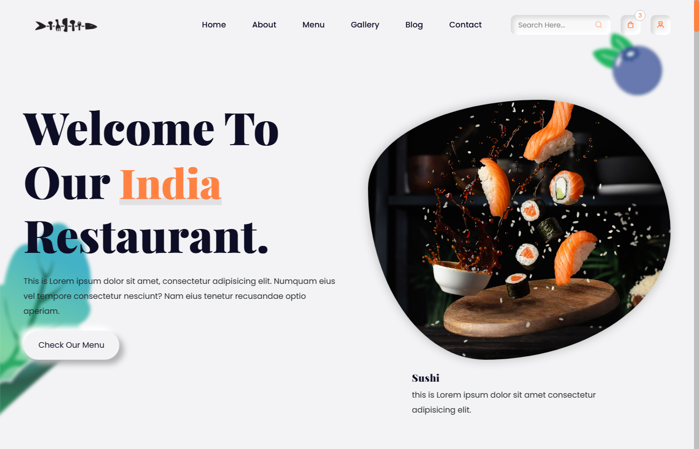
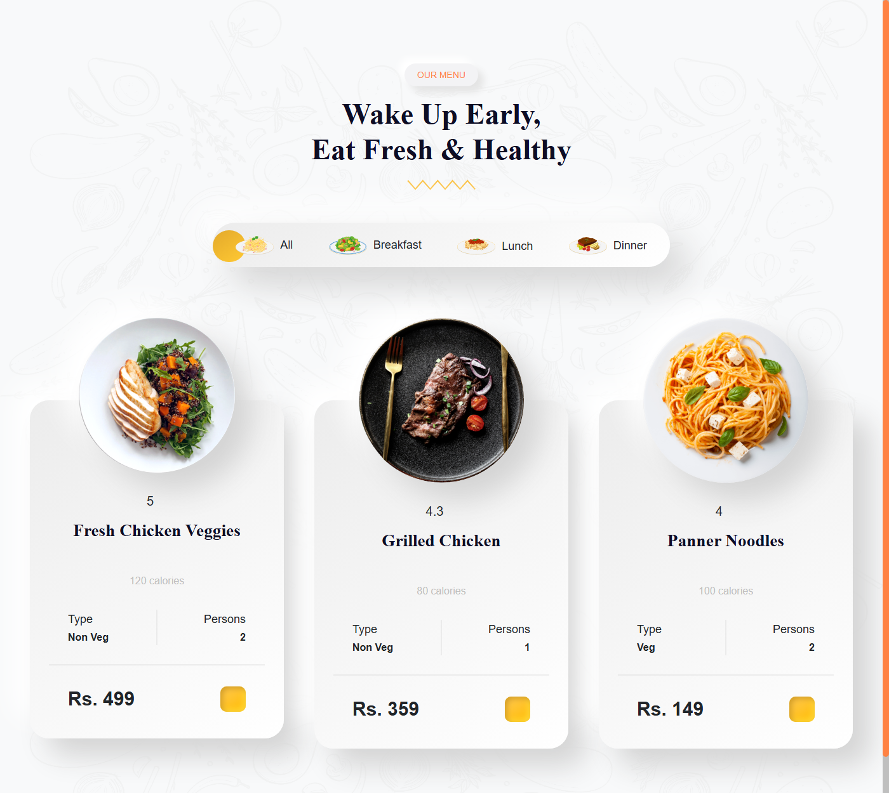
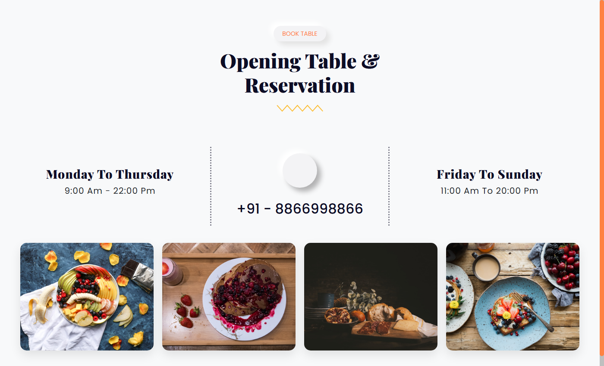

# Food Website

A responsive restaurant / food landing page for showcasing menu, gallery, chefs, testimonials, and blog, with table reservation section and modern food theme.

## Screenshots

### Hero Banner


### Interactive Menu


### Table Reservation & Gallery


## Features

- Responsive navbar with mobile menu toggle
- Full-screen hero banner with parallax floating ingredients
- About section with video story popup
- Interactive food menu with category filtering
- Book a table section with opening hours
- Gallery grid with image zoom and lightbox
- Chefs team and testimonials sliders
- FAQ accordion and blog preview
- Newsletter and contact footer
- Scroll animations and back-to-top button

## Technologies

- HTML
- CSS
- JavaScript
- Bootstrap
- GSAP
- Swiper
- MixItUp
- Fancybox
- Parallax.js
- Unicons

## Project Structure

```text
css/
JS/
views/
Resources/img/
screenshots/
README.md
```

## Notes

> **Note:** This is a university training project based on the original Food Website template by its respective authors. It was recreated for learning purposes and customized during training to practice responsive layouts, Bootstrap components, CSS variables for theming, scroll animations, menu filtering, sliders, and basic frontend structure.
